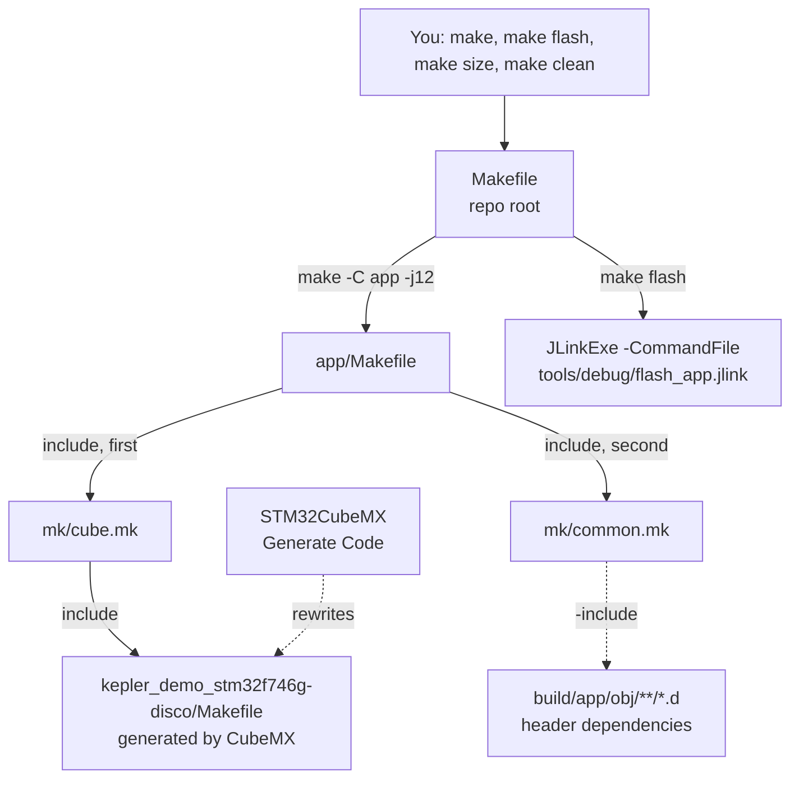
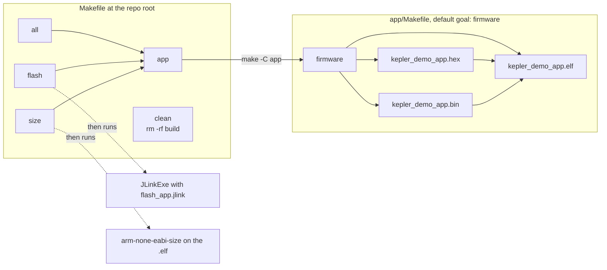
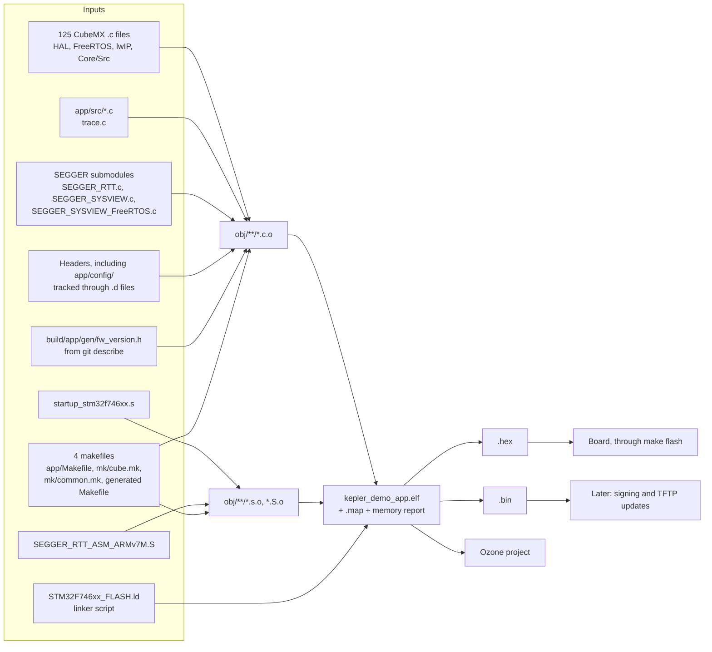
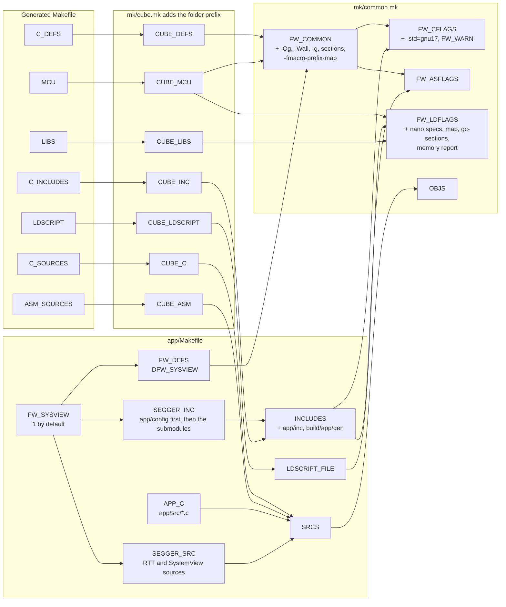

# Build Dependency Map

How the makefiles call and include each other, which targets depend on which,
how files become the image you flash, and what makes `make` rebuild. The charts
are Mermaid diagrams: GitHub renders them, and so does VS Code's Markdown
preview with the Markdown Preview Mermaid Support extension.

From `Makefile`, `mk/cube.mk`, `mk/common.mk` and `app/Makefile` as of Nov 27,
2026. The dependency list was confirmed with `make -p`. See
[build_system.md](build_system.md) for the full description.

## 1. Who runs and includes what

- **Two make processes run.** The root `Makefile` starts a second `make` inside
  `app/`. Everything that builds firmware happens in that second one.
- **Order matters.** `app/Makefile` includes `mk/cube.mk` first, which pulls in
  CubeMX's Makefile and its variables. Our own settings come after it, so they
  win where names clash, such as `TARGET`.
- **The generated Makefile is read, never run.** Its rules are loaded but never
  used.
- **The `.d` files** are written by the compiler, one per object. They list
  each header the source file included, so make can tell when a header changed.

## 2. Targets

- **`all`, `app`, `flash`, `size` and `clean` are phony targets:** names for
  actions, not files. `app` always starts the sub-make, which takes a fraction
  of a second when nothing changed.
- **`flash` and `size` build first,** so you never flash or measure a stale
  image.

## 3. Files: from sources to the board

- **The SEGGER sources are only built when `FW_SYSVIEW` is 1,** the default.
  `fw_version.h` is only included by `trace.c`, so a new version rebuilds just
  that file.

- **Each arrow is a dependency make checks.** If anything on the left is newer
  than what it points to, make rebuilds the target and everything after it.
- **Every object depends on all four makefiles.** Changing any of them,
  including CubeMX regenerating its Makefile, rebuilds everything. The root
  `Makefile` isn't one of the four, because it doesn't affect how files are
  compiled.
- **Objects mirror the source tree** under `build/app/obj/` and keep their
  extension: `Core/Src/main.c` becomes `.../Core/Src/main.c.o`.

## 4. Variables: where the settings come from

- **Only seven variables cross over from CubeMX.** Everything else in the
  generated Makefile, such as its `CFLAGS`, `LDFLAGS` and `BUILD_DIR`, is
  ignored.
- **`FW_WARN`** is empty for CubeMX and SEGGER files and `-Wextra` for files
  under `app/`, set by a pattern-specific variable in `app/Makefile`.
- **`FW_SYSVIEW`** decides three things at once: whether the SEGGER sources
  are built, whether their include folders are used, and, through
  `-DFW_SYSVIEW`, whether the hooks in CubeMX's files are compiled in.

## What makes make rebuild

| You change | Rebuilt | Why |
| ---------- | ------- | --- |
| One `.c` file | That object, then the link | The source is newer than its `.o` |
| A header | Every object whose `.d` file lists it, then the link | The `.d` files are dependencies too |
| The linker script | The link only | The `.elf` depends on it directly |
| Any of the four makefiles | Everything | Every object depends on them |
| CubeMX Generate Code | Everything | It rewrites the generated Makefile, one of the four |
| A new file in `app/src/` | That object, then the link | `APP_C` finds it with a wildcard |
| The root `Makefile` | Nothing | It only starts the sub-make and runs tools |
| A new commit, or uncommitted changes appearing or going | `trace.c`, then the link | The version changes, so `fw_version.h` is rewritten |
| A SEGGER submodule moved to another tag | The SEGGER files that changed, and every file including a changed SEGGER header | Its sources and headers are dependencies like any others |
| **Only a flag on the command line, such as `FW_OPT=-O2` or `FW_SYSVIEW=0`** | **Nothing** | Make tracks files, not flags. Run `make clean` first. Fixing this is part of the deferred variants plan in [TODO.md](../TODO.md#build) |
