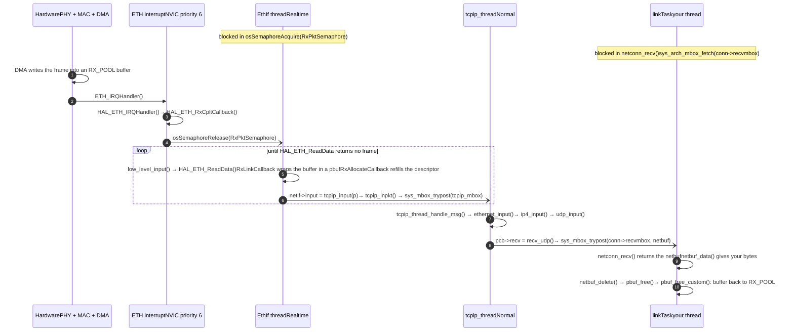
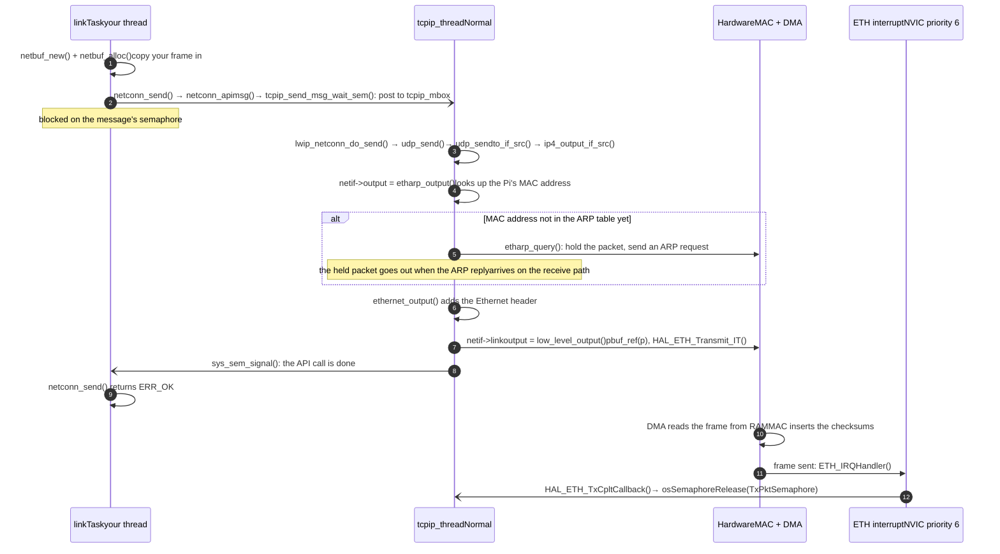

STM32F746G-DISCO · lwIP + FreeRTOS (CMSIS-RTOS v2) · CubeMX 6.18.1

# lwIP Call Flow

How one UDP datagram travels between the Ethernet hardware and `linkTask`, in each direction. Function names come from this project's generated code and the lwIP and HAL sources it ships with.

## Who runs what

Each column in the diagrams is a separate execution context. Work passes between them only through a semaphore or a message queue.

| Context | Priority | Stack | Waits on | Job |
| --- | --- | --- | --- | --- |
| Hardware | n/a | n/a | n/a | LAN8742 PHY, MAC and DMA move frames between the wire and RAM |
| `ETH_IRQHandler` | NVIC 6 | Main stack | n/a | Only releases a semaphore |
| `EthIf` | Realtime (48) | 350 B, raising to 1024 | `RxPktSemaphore` | Turns DMA buffers into pbufs, posts them to `tcpip_thread` |
| `tcpip_thread` | Normal (24) | 4096 B | `tcpip_mbox` (6 slots) | All of lwIP: ARP, IP, UDP, TCP, timers, TFTP |
| `linkTask` | Yours | Yours | `conn->recvmbox` | Your telemetry link, through the netconn API |

Function call in the same context Hand-off to another context (semaphore or queue)

## Receiving: wire to `linkTask`

- **The interrupt does one thing.** `HAL_ETH_RxCpltCallback` in `ethernetif.c` only releases `RxPktSemaphore`. Because the interrupt calls an RTOS function, its NVIC priority must be 5 or higher (`configLIBRARY_MAX_SYSCALL_INTERRUPT_PRIORITY`). It's 6.
- **Zero copy.** The DMA writes straight into an `RX_POOL` buffer, and the pbuf wraps that same memory. Nothing is copied until you copy it out of the netbuf.
- **Free your netbuf promptly.** The pool has 12 buffers. Every netbuf you hold keeps one. When all 12 are held, reception stops. `pbuf_free_custom` then releases `RxPktSemaphore` so `EthIf` can refill the ring.
- **Drops happen quietly.** If `tcpip_mbox` (6 slots) or your `recvmbox` is full, `sys_mbox_trypost` fails and the packet is freed. UDP doesn't retry, so your protocol's sequence numbers will show the gap.

## Sending: `linkTask` to wire

- **No transmit thread.** Everything from `lwip_netconn_do_send` to `HAL_ETH_Transmit_IT` runs inside `tcpip_thread`.
- **`netconn_send` returns before the frame is on the wire.** `HAL_ETH_Transmit_IT` only queues a DMA descriptor. That's why the example copies the frame with `netbuf_alloc`: with `netbuf_ref` the DMA would read your own buffer later, so you couldn't reuse it straight away.
- **`TxPktSemaphore` is usually not waited on.** `low_level_output` waits on it only when `HAL_ETH_Transmit_IT` reports the descriptor ring is busy. It then calls `HAL_ETH_ReleaseTxPacket`, which frees the sent pbufs through `HAL_ETH_TxFreeCallback`, and retries. So sent pbufs stay allocated until the ring fills up.
- **The first packet to the Pi costs an ARP round trip.** lwIP's default `ARP_QUEUEING` is 0, so only the latest packet is held while it waits. Send a few packets in a row at start-up and the earlier ones are dropped.

## Rules for your code

### Only `tcpip_thread` touches lwIP's core

From `linkTask`, use the netconn or socket API. They post a message and block, as in step 2 of the send path. Don't call `udp_send`, `udp_new` or `tcp_write` from your own thread.

### TFTP runs inside `tcpip_thread`

lwIP's TFTP server uses the raw API, so its callbacks are called straight from `udp_input`, with no `recvmbox` step. Keep them short: hand slow work such as flash erases to another thread.

Sources: `LWIP/Target/ethernetif.c`, `LWIP/App/lwip.c`, `Middlewares/Third_Party/LwIP/src/api/` (tcpip.c, api_lib.c, api_msg.c), `src/core/` (udp.c, ipv4/ip4.c, ipv4/etharp.c), `src/netif/ethernet.c`, `system/OS/sys_arch.c` and `stm32f7xx_hal_eth.c`.